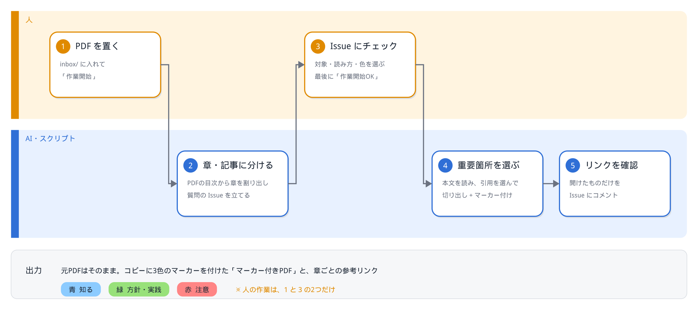
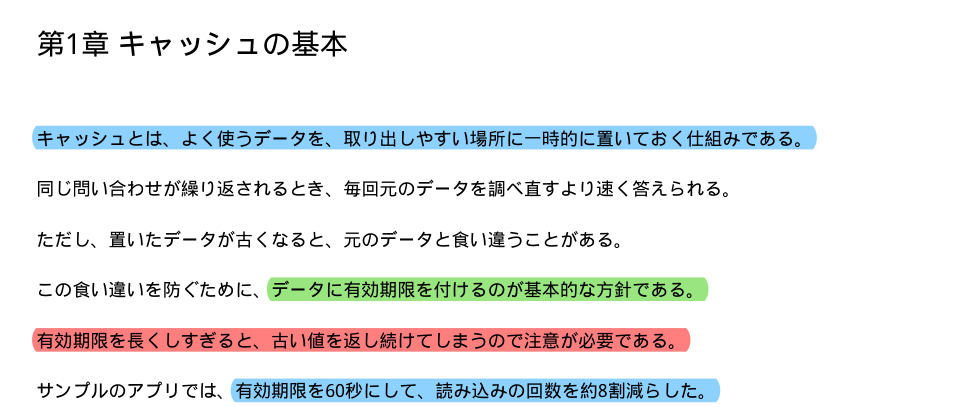
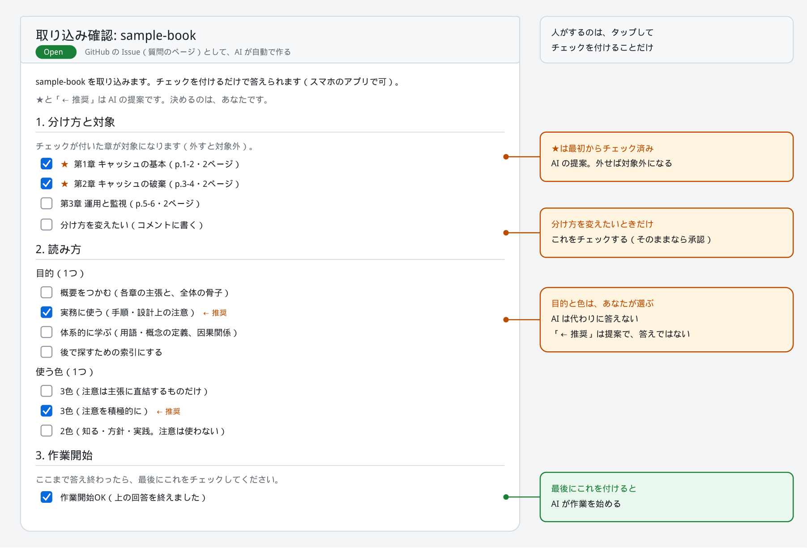

# dopagaki-publications-highlighter

雑誌PDFや書籍PDFから、読みたい記事（書籍は章）だけを切り出し、重要な箇所に3色のマーカーを付けるツール。
章・記事ごとの参考文献・関連リンク（取得して確認済みのものだけ）は、GitHub Issue のコメントにまとめる。



詳しい図は [docs/flow.md](docs/flow.md)。

出力は、元のPDFをコピーして、重要箇所に色を付けたもの（使用例の1ページ目）。



| 色 | 意味 |
|---|---|
| 青 | 知る（定義・根拠・数値） |
| 緑 | 方針・実践（原則・具体的にやること） |
| 赤 | 注意（やってはいけないこと・限界） |

- 元PDFは書き換えず、コピーに注釈を追記する。再実行しても重複しない
- PDF はコミットしない（著作物のため `.gitignore` で除外）

## このリポジトリについて

自分が雑誌・技術書を効率よく読むために作った、個人用のツールです。商業利用は想定していません。同じように読みたい人が、自分の読書のために使ったり、改造したりするのは自由です。

- **ライセンス**: [PolyForm Noncommercial 1.0.0](LICENSE)。非商業目的（個人の学習・趣味・研究など）なら、使う・改造する・配るのは自由です。商業目的での利用はできません。OSI が定める「オープンソース」ではなく、ソース公開のライセンスです
- **著作物は含みません**: 雑誌・書籍のPDFは置いていません（`.gitignore` で除外）。各自で入手したPDFを使ってください。`output/`（作業フォルダ）の中身も、コミットしないようにしてあります。`examples/` の本は、説明用に書いた架空の内容です。実在の書籍・雑誌の本文の著作権は、各出版社・著者にあります
- **依存ライブラリ**: PDFの処理に [PyMuPDF](https://pymupdf.readthedocs.io/)（AGPL-3.0 / 商用ライセンスの二重ライセンス）を使います。同梱はせず、`uv sync` で各自の環境に入れます。PyMuPDF 自身の条件は、そちらに従ってください
- **無保証**: 動作や結果は保証しません

Required Notice: Copyright (c) 2026 Enomoto Kota

## 使用例

架空の短い本で、入力（元PDF・`articles.json`・`highlights/*.json`）と出力（切り出し・マーカー付きPDF）を確かめられる。[examples/](examples/README.md)

## 動かすのに必要なもの

**基本的に、自分のPCの中で完結します。** サーバーやクラウドに置く部分はありません。PC の外に出るのは、次の2つだけです。

- PDF の本文が、**Claude**（Anthropic）に渡ります。本文を読んで重要箇所を選ぶのが Claude の役目だからです
- 質問と参考文献が、**GitHub の Issue** に書き込まれます

| 必要なもの | 用途 | 準備 |
|---|---|---|
| [Claude Code](https://claude.com/claude-code) | 本文を読み、重要箇所と参考リンクの候補を選ぶ（`claude` コマンドを呼びます） | インストールして、ログインしておく。Claude Code の利用枠・料金を使います |
| [GitHub CLI](https://cli.github.com/)（`gh`） | 質問の Issue を作り、回答とコメントをやり取りする | インストールして、`gh auth login` を済ませておく |
| GitHub のリポジトリ | Issue を作る置き場所 | 下の注意を参照 |
| [uv](https://docs.astral.sh/uv/) と Python 3.11 以上 | スクリプトの実行 | インストールする（`uv sync` で、残りの依存を入れる） |
| PDF | 読みたい雑誌・書籍 | 各自で用意する。元のPDFは書き換えません |

- **Issue は、このフォルダの git の `origin`（クローン元ではなく、自分のリポジトリ）に作られます。** 自分用の **private リポジトリ**にしておくのがおすすめです。Issue に、章の見出しや参考リンクが載るためです
- **ダブルクリックで始める画面（`作業開始.bat`）は、Windows 向けです。** 手でコマンドを実行する使い方は、他の OS でも動くはずですが、確認していません
- 回答を待つ間は、PC を起動したまま、見張りの黒いウィンドウを開いておきます（閉じると止まります。もう一度起動すれば再開します）
- 雑誌・書籍の本文は著作物です。**自分が読むための私的な利用**にとどめ、PDFや本文の引用を、人に配らないでください

## 用語

| 用語 | 意味 |
|---|---|
| 目次（PDFの「しおり」） | PDFビューアの左側に出る、章や記事の一覧（ブックマーク）。章・記事の範囲を自動で割り出すのに使う。無いPDFは、ページ範囲を手で指定する |
| 記事・章 | 切り出す単位。雑誌は記事、書籍は章 |
| 重要箇所 | 本文から選んだ、マーカーを付ける文。`highlights/<ID>.json` に、本文の引用・色・理由を残す |
| Issue | GitHub の「質問やメモを書くページ」。チェックボックスが付けられ、スマホのアプリからも答えられる |

## セットアップ

[uv](https://docs.astral.sh/uv/) と Python 3.11 以上が必要。

```bash
cd app
uv sync
```

## 使い方（概要）

**`作業開始.bat` をダブルクリック**すると、ブラウザで画面が開く。PDF をアップロードすると、取り込みから、回答待ち（Issue）までを自動で行う（[docs/workflow.md](docs/workflow.md) の「ダブルクリックで始める」）。

手で行うときは、**PDF 1つ（雑誌は1号、書籍は1冊）ごとに**、PDF と同じ名前（拡張子なし）のフォルダ `output/<PDF名>/` を作り、その中に PDF を置く。そのあと `app/` で、次の順に実行する。

```bash
cd app
# 1. 記事（書籍は章）を一覧にする。結果は output/<PDF名>/articles.json に残る
uv run python plan_issue.py --pdf ../output/<PDF名>/<PDF名>.pdf
# 2. 対象にする記事を記録する（ID は一覧に出るページ範囲。例: p100-105）
uv run python plan_issue.py --pdf ../output/<PDF名>/<PDF名>.pdf --include p100-105 p120-126
# 3. 本文を読み、重要箇所を output/<PDF名>/highlights/<ID>.json に書く
# 4. 切り出したPDF（分割/<記事名>.pdf）と、マーカー付きPDF（マーカー付き/<記事名>.pdf）を一括で作る
uv run python build_issue.py --plan ../output/<PDF名>/articles.json
```

書籍は、章に分ける案を作り、人が分け方を承認してから切り出す（PDF は `inbox/` に置く）。流れは [docs/workflow.md](docs/workflow.md) の「書籍を取り込む手順」。実際に動かした例は [examples/](examples/README.md)。

### 質問の Issue

分割案ができると、AI が次のような Issue を1つ作ります。あなたは、チェックを付けるだけで答えます（スマホの GitHub アプリでも可）。最後の「作業開始OK」を付けると、続きが自動で進みます。



## 構成

```
app/          スクリプト（PyMuPDF）とテスト
inbox/        書籍PDFの受け取りフォルダ（PDFを置く。`.gitkeep` だけ git に入る）
output/       作業フォルダ（元PDF・articles.json・highlights/*.json・成果物。中身はコミットしない）
  <PDF名>/    PDFごとのフォルダ（雑誌も書籍も同じ形）
examples/     架空の本の使用例（入力と出力）
docs/         全体の流れの図（flow.md）、運用の手順（workflow.md）、重要箇所の選定基準（highlight-criteria.md）、実績の記録（records.md）
```

## 開発

```bash
cd app
uv run pytest          # ダミーPDFを生成して検証（実PDF不要）
uv run ruff check .    # Lint
```
