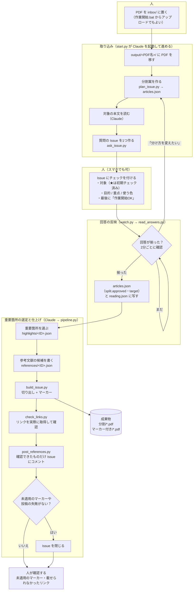
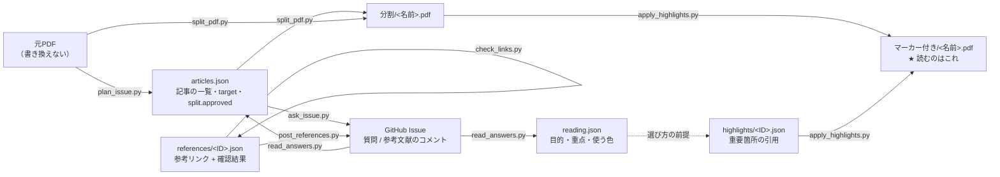
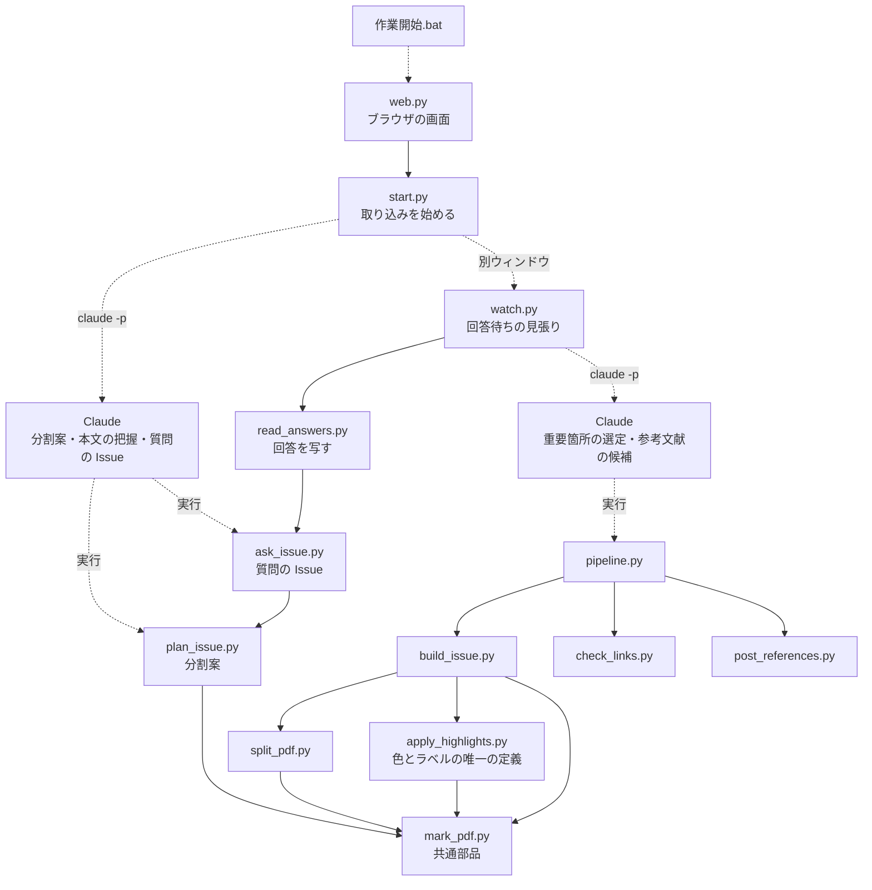

# 全体の流れ

雑誌・書籍のPDFから、読みたい記事（書籍は章）だけを切り出し、重要箇所に3色のマーカーを付けるまでの流れ。手順の細部は [workflow.md](workflow.md)。

人の作業は「PDF を置く」と「Issue にチェックを付ける」の2つだけ。残りはスクリプトと AI（Claude）が進める。

## 1. 作業の流れ（誰が何をするか）

## 2. データの流れ（何が正で、何が作り直せるか）

`output/<PDF名>/` の中の JSON が正。PDF は JSON から作り直せる生成物。

## 3. スクリプトのつながり（`app/`）

実線は `import`（コードから呼ぶ）、点線は別のプロセスとして起動する関係。`mark_pdf.py`（PDF を開く・注釈つきコピーを書く共通部品）が土台。

## 色の意味

| 色 | 意味 | ラベル |
|---|---|---|
| 青 | 知る | `definition` 定義 / `evidence` 根拠・数値 |
| 緑 | 方針・実践 | `principle` 原則・主張 / `practice` 実践 |
| 赤 | 注意 | `warning` 注意・限界 |

定義は `app/apply_highlights.py` の `GROUPS` / `CATEGORIES`。
